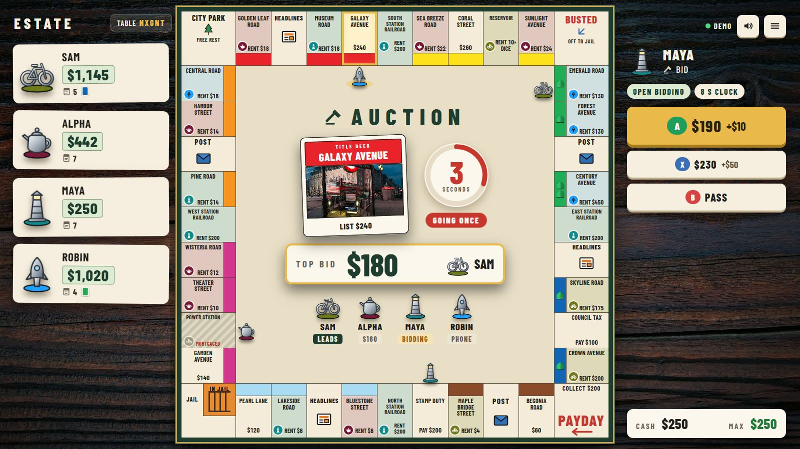
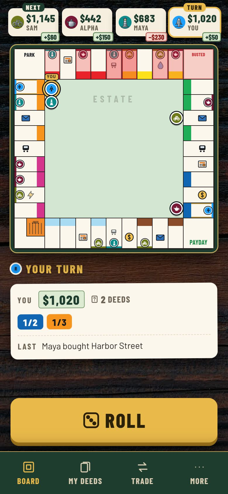
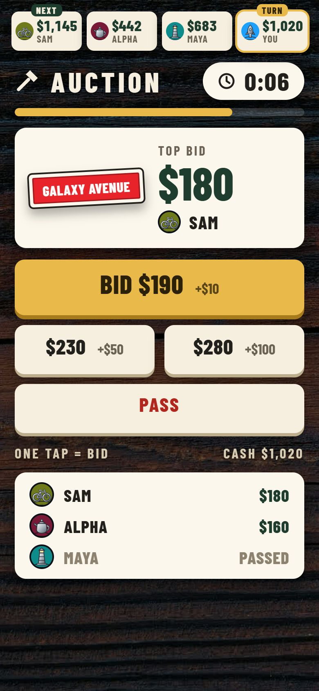
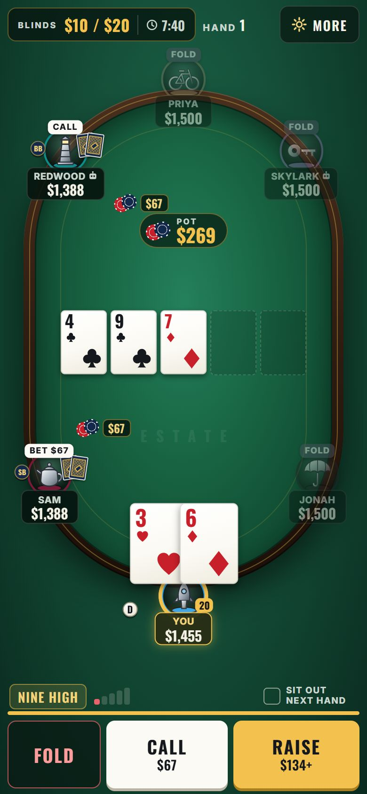
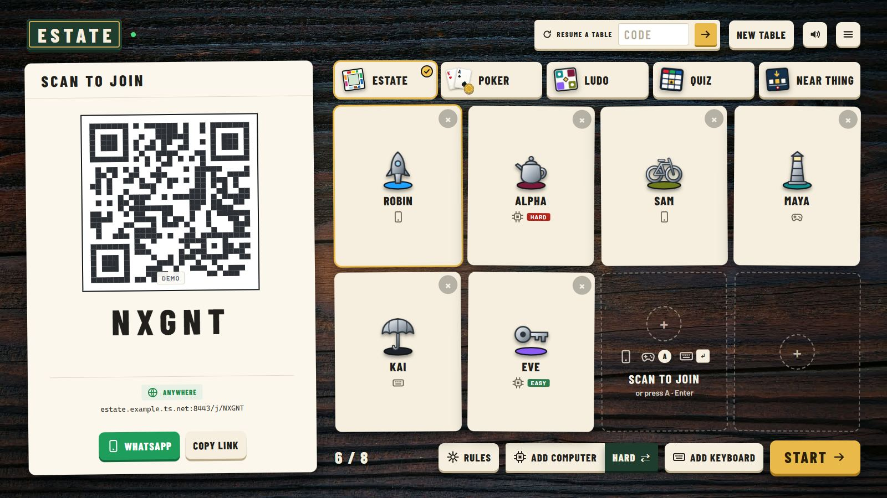

# Estate

Estate is a party game server for game night: the TV shows the board, and everyone plays on their own phone.
One small Go program runs five games, with Estate, a property-trading board game, as the main one.



<p>
  
  
  
</p>

## What's in it

- **Five games on one server:** Estate (property trading), Texas Hold'em poker, Ludo, a quiz, and
  Near Thing (guess a number, then bet on whose guess is closest).
- **TV plus phones.** The TV is the shared screen at `/`. Phones join at `/play` by scanning the QR
  code or typing the 5-character code. No app store, no accounts.
- **Up to 8 players**, with computer players at several levels (Estate has five, from Easy to
  Grandmaster).
- **Keyboard and game controller seats** on the TV for Estate and Ludo, for people without a phone.
- **Timed open auctions**, house rules (loans, City Park jackpot, starting cash) and host controls
  during the game.
- **Nobody gets stuck.** If a player drops out of Estate, poker or Ludo, the computer
  stands in for them with safe moves until they are back.
- **Games survive a restart.** Open games are saved and restored. Every game is also kept as a
  record, and Estate records can be replayed and analysed with `cmd/estate-replay`.
- **Works offline on your own Wi-Fi.** Fonts, photos and pages are built into the binary.



## Quick start

You need [Go](https://go.dev/dl/) 1.27.3 or newer (see `go.mod`).

```sh
go build ./cmd/estate
./estate
```

That serves on port 3210 and opens the TV screen in your browser. The log prints the address
phones should use, for example `phones on this network: http://<this computer>:3210/play`. Phones
on the same Wi-Fi can also just scan the QR code on the TV. If your firewall asks, allow Estate on
private networks.

To run it without opening a browser:

```sh
./estate serve --no-open
```

### Settings

Each flag can also be set with an environment variable.

| Flag | Environment | Default | What it does |
|---|---|---|---|
| `--addr` | `ESTATE_ADDR` | `:3210` | Address to listen on |
| `--public-url` | `ESTATE_PUBLIC_URL` | none | Base URL for invite links and QR codes, when phones reach the server through a domain or tunnel |
| `--data` | `ESTATE_DATA` | see below | Where devices, friends, open games and game records are kept |
| `--no-open` | | off | Don't open the TV screen in a browser |
| `--poker-bot` | `ESTATE_POKER_BOT` | none | Optional external poker AI for "hard" poker seats (see [docs/POKER-API.md](docs/POKER-API.md)) |

The data folder defaults to `~/.local/share/estate` on Linux, `%AppData%\estate` on Windows and
`~/Library/Application Support/estate` on macOS.

`estate version` prints the version, and `estate help` lists the commands.

## Try the screens without playing

Every screen has a demo that needs no game. With the server running:

- **TV:** `http://localhost:3210/?demo=t-auction-timed-going`. The names are in
  `web/fixtures/t-index.json`.
- **Phone:** `http://localhost:3210/play?demo=scene&s=your-turn`. The scene ids are in
  `web/phone/scenarios.js`.
- **Other games:** use a fixture name from `web/fixtures/poker`, `ludo`, `quiz` or `closest`, for
  example `/play?demo=poker-flop-phone` or `/?demo=quiz-answer-table`.

## Hosting

- **At home:** run `estate` on a computer on the same Wi-Fi as the phones. That's all you need.
- **Linux service:** `deploy/install-linux.sh` installs the binary and a systemd user service.
  Settings go in `~/.config/estate/estate.env`.
- **Over the internet with Tailscale:** `deploy/funnel-on.sh` shares the server with Tailscale
  Funnel on port 8443, and `deploy/funnel-off.sh` stops it.
- **deploy/aws:** scripts for a small AWS server, see [deploy/aws/README.md](deploy/aws/README.md).

Behind a reverse proxy, run the proxy on the same machine: Estate only trusts `X-Forwarded-For`
from a loopback address. The server has room limits and per-address rate limits built in (see
[docs/API.md](docs/API.md), "Limits and overload protection").

## Documentation

- [docs/API.md](docs/API.md): how the server and the games work, and the HTTP and WebSocket API
- [docs/POKER-API.md](docs/POKER-API.md), [docs/LUDO-API.md](docs/LUDO-API.md),
  [docs/QUIZ-API.md](docs/QUIZ-API.md), [docs/CLOSEST-API.md](docs/CLOSEST-API.md): one file per game
- [docs/GAME-RECORDS.md](docs/GAME-RECORDS.md): the game record format and replays
- [docs/ai](docs/ai): how the strongest Estate computer players were built

## Contributing

Bug reports, ideas and pull requests are welcome. Start with [CONTRIBUTING.md](CONTRIBUTING.md),
and please follow the [Code of Conduct](CODE_OF_CONDUCT.md). To report a security problem, see
[SECURITY.md](SECURITY.md).

## Credits

- **Upstream:** Fork of [5968qqq/classic-estate](https://github.com/5968qqq/classic-estate) (MIT).
  Its browser client is still served at `/classic/`, and its JavaScript engine (`src/`) is the
  reference the Go engine is tested against.
- **Poker engine:** the hand evaluator and card code are forked from
  [alexclewontin/riverboat](https://github.com/alexclewontin/riverboat) (BSD-2-Clause, Copyright (c)
  2020 Alex Lewontin). See [LICENSE-riverboat](LICENSE-riverboat).
- **Photos:** from Wikimedia Commons under CC BY, CC BY-SA or CC0. Each photo keeps its own licence;
  authors and links are in [web/shared/photos/CREDITS.txt](web/shared/photos/CREDITS.txt).
- **Fonts:** Oswald, Inter, Barlow and Barlow Condensed, under the SIL Open Font License 1.1. See
  [web/shared/fonts/README.md](web/shared/fonts/README.md).
- **Icons:** most icons in `public/icons.svg` are from [Lucide](https://lucide.dev) (ISC, with the
  icons it took from Feather under MIT), some adapted; the rest are drawn to match. See
  [public/LICENSE-lucide.txt](public/LICENSE-lucide.txt).
- **Go libraries:** [coder/websocket](https://github.com/coder/websocket) and
  [rsc.io/qr](https://pkg.go.dev/rsc.io/qr), see `go.mod`.

Estate is an independent project. It is not affiliated with or endorsed by any tabletop game
publisher.

## License

MIT, see [LICENSE](LICENSE). The photos, fonts, icons and the forked poker code keep their own
licences, listed above.
